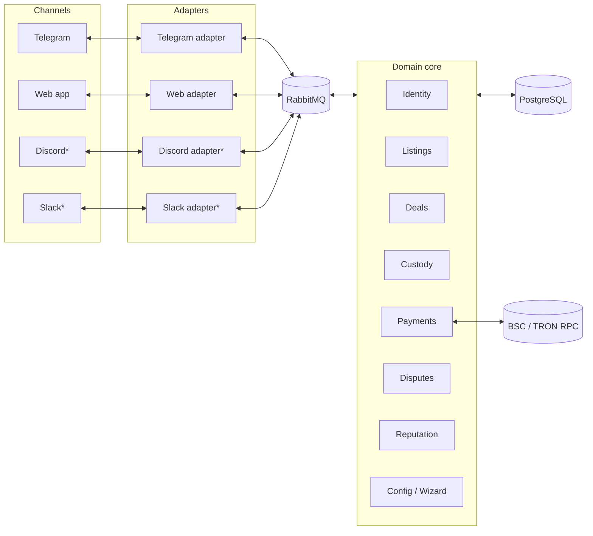
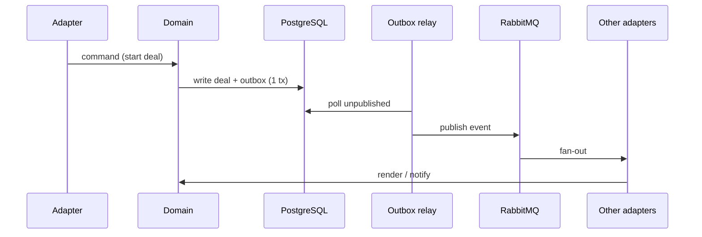

# 02 — Architecture

## 1. Shape

A **modular monolith** with hexagonal ports. One deployable process runs the domain
core, the operator/web HTTP surface, and the first-party adapters. Adapters can later be
split into workers without changing the domain.



`*` = specified only, not built in the first release.

## 2. Modules

| Module | Owns | Does not own |
|---|---|---|
| Identity | `account`, `channel_identity`, verification state | authorization roles (none) |
| Listings | `listing`, lifecycle, publication | channel rendering |
| Deals | `deal`, state machine, participants, frozen terms | key material, chain I/O |
| Custody | `address_pool`, assignment, sweep instructions | deal decisions |
| Payments | chain watcher, deposit crediting, INR proof intake | release decision |
| Disputes | `dispute`, evidence, operator verdict | funds movement (delegates to Custody) |
| Reputation | completed count + volume per account | ranking/search |
| Config | wizard answers, runtime settings, fee | secrets at rest |
| Adapters | render/send, room lifecycle, inbound commands | domain rules |

## 3. Ports

The domain depends only on interfaces:

- `ChannelPort` — messaging, actions, rooms, files, membership, moderation. See
  `05-adapters.md`.
- `ChainPort` — `watchAddress`, `getTransaction`, `confirmations`, `buildTransfer`.
- `Clock`, `IdGenerator`, `EventPublisher`.
- `Store` — repositories per aggregate.

Adapters depend on the domain's **application services**, never on repositories.

## 4. Events

Domain changes append to an `outbox` table in the same DB transaction. A relay publishes
to RabbitMQ; adapters consume. This gives at-least-once delivery, safe retries, and an
easy path to split services.



### Envelope

```json
{
  "event_id": "uuid",
  "type": "deal.deposit_confirmed",
  "version": 1,
  "occurred_at": "2026-10-30T12:00:00Z",
  "aggregate_id": "deal_01J...",
  "adapter": "telegram",
  "correlation_id": "uuid",
  "causation_id": "uuid",
  "payload": {}
}
```

### Catalog (v1)

`account.created`, `account.verified`, `listing.created`, `listing.published`,
`listing.closed`, `deal.created`, `deal.room_ready`, `deal.participant_joined`,
`deal.form_submitted`, `deal.details_submitted`, `deal.summary_posted`,
`deal.confirmed`, `deal.address_assigned`, `deal.deposit_detected`,
`deal.deposit_confirmed`, `deal.inr_submitted`, `deal.release_requested`,
`deal.released`, `deal.completed`, `deal.cancelled`, `deal.expired`,
`deal.disputed`, `dispute.evidence_added`, `dispute.resolved`,
`reputation.updated`.

Consumers must be idempotent keyed on `event_id`. Undeliverable messages go to a
per-adapter dead-letter queue after 5 attempts with exponential backoff.

## 5. Concurrency and consistency

- Deal transitions are optimistic-locked on `deal.version`; a conflicting transition
  returns a domain error and the adapter renders it.
- A deal may hold **one** assigned address at a time; assignment is `SELECT … FOR UPDATE
  SKIP LOCKED` over the free pool.
- Chain watcher and adapter actions are idempotent: chain by `(tx_hash, log_index)`,
  inbound commands by `(adapter, external_message_id)` when the channel exposes one.
- Money is stored as integer base units (`amount_atomic`, `decimals`), never floats.

## 6. Boundaries

- The domain never imports a channel SDK.
- Adapters never write domain tables directly.
- Key material lives outside the DB (see `07-custody-and-payments.md`).
- Public web and inbound webhooks terminate at the reverse proxy; the app trusts a
  single `X-Forwarded-*` hop.

## 7. Failure modes

| Failure | Behavior |
|---|---|
| Broker down | Commands still commit; outbox grows; relay retries |
| Chain RPC down | Deal stays `awaiting_deposit`; watcher backs off; operator sees health |
| Adapter offline | Outbox per adapter pads; room actions queue |
| Duplicate webhook | Deduped by external id |
| Crash mid-transition | Transaction rolls back; outbox not published; safe replay |
