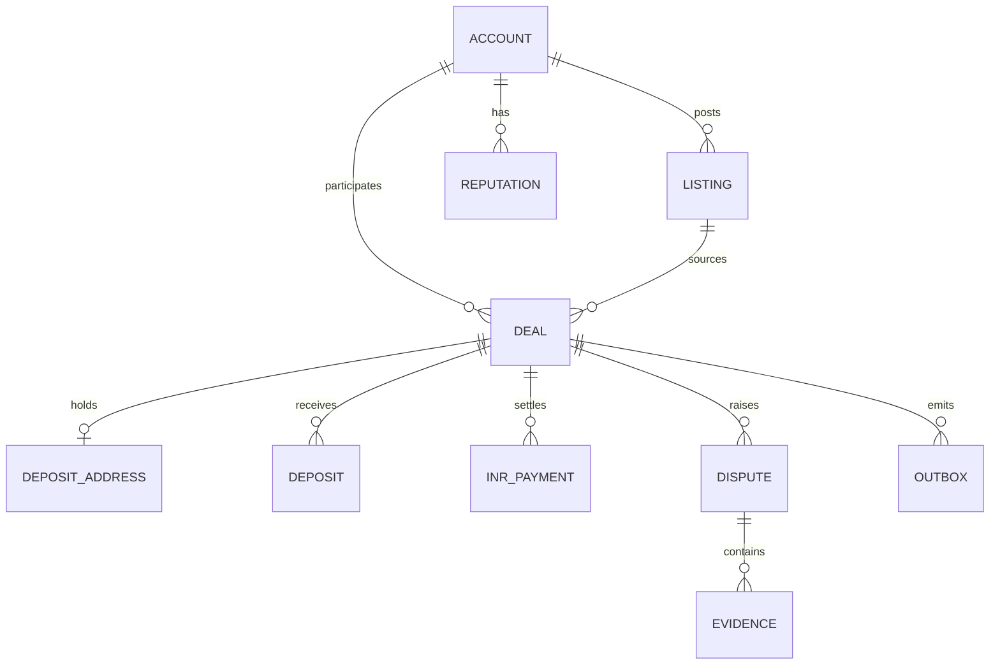

# 03 — Domain Model

All money columns are integer base units with an explicit `decimals`. No floats.

## 1. Entities

### `account`

| Field | Type | Notes |
|---|---|---|
| `id` | uuid | PK |
| `adapter` | enum | `telegram`, `web`, `discord`, `slack` |
| `external_id` | text | TG user id, OIDC `iss:sub` |
| `display_name` | text | last seen |
| `handle` | text null | channel handle, if any |
| `verification_state` | enum | `none`, `pending`, `verified` |
| `created_at` | timestamptz | |

Unique `(adapter, external_id)`. Accounts never merge across adapters.

### `listing`

| Field | Type | Notes |
|---|---|---|
| `id` | uuid | PK |
| `account_id` | uuid | issuer |
| `adapter` | enum | must match account |
| `side` | enum | `sell` / `buy` (USDT perspective) |
| `chain` | enum | `bsc` / `tron` |
| `asset` | text | `USDT` (v1) |
| `amount_usdt_atomic` | numeric(38) null | optional |
| `amount_inr_atomic` | numeric(38) | |
| `rate_inr_per_usdt` | numeric(18,6) | |
| `payment_methods` | text[] | `cdm`, `ccw`, `upi`, `imps`, `qr_cash` |
| `fee_payer` | enum | `buyer`, `seller`, `split` |
| `status` | enum | `draft`, `published`, `matched`, `closed`, `expired` |
| `community_ref` | jsonb | adapter message ref |
| `expires_at` | timestamptz | |

### `deal`

| Field | Type | Notes |
|---|---|---|
| `id` | uuid | PK |
| `public_id` | text | e.g. `D51700`; unique, non-sequential display id |
| `adapter` | enum | single-channel deal |
| `room_ref` | jsonb | adapter room handle |
| `buyer_account_id` | uuid | same adapter |
| `seller_account_id` | uuid | same adapter |
| `listing_id` | uuid null | optional source |
| `chain` | enum | |
| `asset` | text | |
| `decimals` | int | 6 for USDT |
| `amount_atomic` | numeric(38) | crypto amount |
| `amount_inr_atomic` | numeric(38) | fiat amount |
| `fee_atomic` | numeric(38) | platform fee |
| `fee_pct` | numeric(6,4) | from config |
| `fee_min_atomic` | numeric(38) | from config |
| `payment_methods` | text[] | chosen |
| `payment_details` | text | frozen seller instructions |
| `release_address` | text | buyer receive address |
| `refund_address` | text null | seller refund address |
| `state` | enum | see `04-deal-protocol.md` |
| `version` | int | optimistic lock |
| `deposit_address_id` | uuid null | assigned pool address |
| `confirmations_required` | int | 15 / 20 |
| `deadline_at` | timestamptz | per-state timer |
| `frozen_terms_hash` | text | sha256 of frozen summary |
| `dispute_id` | uuid null | |
| `created_at` / `updated_at` | timestamptz | |

### `deposit_address`

| Field | Type | Notes |
|---|---|---|
| `id` | uuid | PK |
| `chain` | enum | `bsc` / `tron` |
| `address` | text | unique per chain |
| `status` | enum | `free`, `assigned`, `cooldown`, `retired` |
| `assigned_deal_id` | uuid null | |
| `assigned_at` / `released_at` | timestamptz | |

### `deposit`

`id, deal_id, chain, tx_hash, log_index, from_address, to_address, amount_atomic,
confirmations, first_seen_at, credited_at` — unique `(chain, tx_hash, log_index)`.

### `inr_payment`

`id, deal_id, amount_inr_atomic, method, proof_files jsonb[], submitted_at,
operator_checked_at, note`.

### `dispute`

`id, deal_id, opened_by_account_id, reason, state (open|resolved|withdrawn),
verdict (release|refund|split), resolved_by, resolved_at, note`.

### `evidence`

`id, dispute_id, kind (file|text|tx|message), ref, hash, added_by, added_at`.

### `reputation`

`account_id, completed_deals int, volume_atomic numeric(38), last_updated_at`.
Derived from events; rebuildable.

### `outbox` / `settings` / `operator_audit`

- `outbox(id, type, version, aggregate_id, payload jsonb, published_at, attempts)`
- `settings(key, value jsonb, updated_at)` — wizard output, fee, thresholds.
- `operator_audit(id, actor, action, target, at, meta jsonb)` — operator actions only.

## 2. Invariants

1. `buyer_account.adapter == seller_account.adapter == deal.adapter`.
2. `buyer != seller`.
3. A deal holds at most one address; an address serves at most one active deal.
4. After `frozen_terms_hash` is set, terms are immutable; a change requires a new deal.
5. `0 <= fee_atomic < amount_atomic`; fee is `max(pct * amount, min)`.
6. `release_address` and `refund_address` match `chain` format.
7. State changes only via the transition table; each change bumps `version`.
8. A released deal cannot be disputed or refunded.
9. Evidence is append-only.
10. `reputation` is derived, never hand-edited.

## 3. PII policy

- Store only channel ids/handles required to operate.
- INR proof files are encrypted at rest and visible only to the operator.
- Public deal pages expose `public_id`, state, amounts, and timestamps — never handles,
  addresses, or proof.
- Deletion request: anonymize `display_name`/`handle`; keep financial records.
