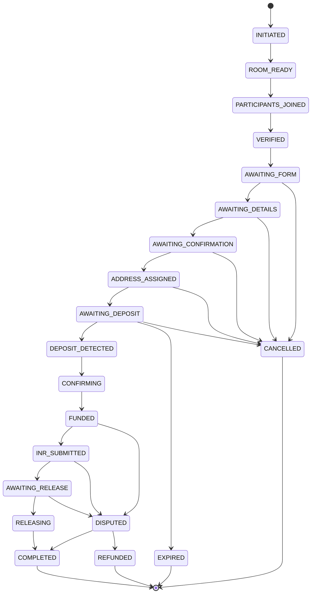

# 04 — Deal Protocol

The state machine is channel-agnostic. Adapters only render transitions; they never
invent them.

## 1. States



| State | Meaning | Terminal |
|---|---|---|
| `INITIATED` | `/escrow` accepted, room being created | no |
| `ROOM_READY` | room exists, invites issued | no |
| `PARTICIPANTS_JOINED` | both accounts in the room | no |
| `VERIFIED` | channel verification satisfied (instant if `none`) | no |
| `AWAITING_FORM` | waiting for the initiator's form | no |
| `AWAITING_DETAILS` | chain, release, refund, payment details | no |
| `AWAITING_CONFIRMATION` | summary posted; both must confirm | no |
| `ADDRESS_ASSIGNED` | pool address reserved; instructions sent | no |
| `AWAITING_DEPOSIT` | waiting for the seller's USDT | no |
| `DEPOSIT_DETECTED` | matching transfer seen | no |
| `CONFIRMING` | counting confirmations | no |
| `FUNDED` | deposit credited; INR may be sent | no |
| `INR_SUBMITTED` | buyer marked paid + proof | no |
| `AWAITING_RELEASE` | waiting for seller release | no |
| `RELEASING` | transfer broadcast | no |
| `COMPLETED` | USDT delivered and INR settled | yes |
| `CANCELLED` | closed before funding | yes |
| `EXPIRED` | deposit window elapsed | yes |
| `DISPUTED` | operator intervention | no |
| `REFUNDED` | USDT returned to seller | yes |

## 2. Transitions

| From | Trigger | Guard | Side effects |
|---|---|---|---|
| INITIATED | `room.created` | both accounts resolved | post deal card, invite both |
| ROOM_READY | `participant.joined` ×2 | distinct accounts | post ready card |
| PARTICIPANTS_JOINED | `verification.satisfied` | both verified or `none` | prompt form |
| VERIFIED | `form.submitted` | fields valid | prompt details |
| AWAITING_FORM | `details.submitted` | chain matches, addresses valid | compute fee, freeze terms, post summary |
| AWAITING_DETAILS | `deal.confirmed` ×2 | both distinct, no edits | assign address, post instructions |
| AWAITING_CONFIRMATION | `address.assigned` | free address exists | start deposit timer |
| ADDRESS_ASSIGNED | `deposit.seen` | to assigned address, amount ≥ required | post detected, start confirmations |
| AWAITING_DEPOSIT | `confirmation.tick` | confirmations ≥ required | credit, post "send INR" |
| DEPOSIT_DETECTED / CONFIRMING | `inr.marked_paid` | proof attached | notify seller |
| FUNDED | `release.requested` | caller is seller | broadcast transfer |
| INR_SUBMITTED | `transfer.broadcast` | tx hash stored | wait for receipt |
| RELEASING | `transfer.confirmed` | receipt success | compute reputation, close room |
| FUNDED/… | `dispute.opened` | party to deal | freeze release, open dispute |
| DISPUTED | `dispute.resolved(release)` | operator verdict | broadcast transfer |
| DISPUTED | `dispute.resolved(refund)` | operator verdict | refund seller, release address |
| AWAITING_DEPOSIT | timer elapses | no deposit | expire, release address |
| pre-funding | `deal.cancel` | mutual or operator | close room, release address |

## 3. Timers

| Timer | Default | On expiry |
|---|---|---|
| form/details | 30 min | cancel |
| confirmation prompt | 15 min | cancel |
| deposit window | 30 min | expire |
| INR window | 30 min | dispute |
| dispute review | operator SLA | stays open |

Timers are channel-agnostic; adapters render countdowns where capable.

## 4. Amounts and fees

```
fee_atomic      = max(floor(amount_atomic * fee_pct), fee_min_atomic)
release_atomic  = amount_atomic - fee_atomic
```

Defaults: `fee_pct = 0.005`, `fee_min_atomic = 0.5e6` (0.5 USDT). All values are
editable in the wizard and frozen into `settings` at deal creation.

## 5. Confirmation policy

| Chain | Default | Range |
|---|---|---|
| BSC | 15 | 1–50 |
| TRON | 20 | 1–50 |

A deposit counts only when `to == assigned address`, `asset == USDT`, and
`amount_atomic >= deal.amount_atomic`. Overpayment credits the deal; the excess is
recorded and returned out-of-band by the operator.

## 6. Canonical content blocks

Adapters render these blocks in their own format; the text is the contract.

- **deal.card**: `Deal #<public_id> · <seller> [Seller] · <buyer> [Buyer] · <state>`
- **summary**: seller, buyer, token, chain, amount, INR, rate, fee, release, refund,
  payment details, limit — one immutable message.
- **deposit.instructions**: address, chain, token, amount, "send only on this network".
- **deposit.detected**: amount, confirmations `n/required`.
- **funded**: "USDT received. Buyer may now send INR." fee, release amount.
- **inr.prompt**: payment details, warning to trust only this room.
- **release.instructions**: irreversible; confirm INR before releasing.
- **dispute.card**: reason, evidence count, operator notified.
- **verdict**: release | refund, amount, note.

## 7. Error contract

Domain errors are typed and rendered verbatim by adapters:

`DEAL_WRONG_STATE`, `DEAL_NOT_PARTICIPANT`, `DEAL_TERMS_FROZEN`, `DEAL_AMOUNT_MISMATCH`,
`ADDRESS_POOL_EMPTY`, `CHAIN_UNSUPPORTED`, `ADDRESS_INVALID`, `FEE_INVALID`,
`DISPUTE_ALREADY_OPEN`, `UNAUTHORIZED_OPERATOR`.
