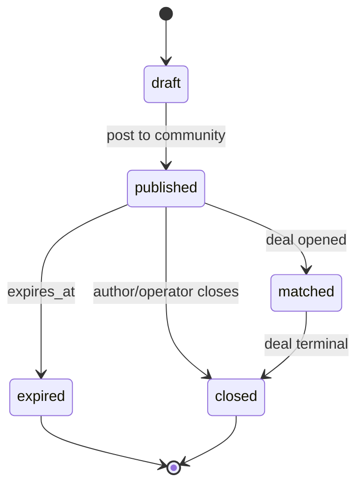

# 06 — Community and Listings

The community is **adapter-native**. The core does not host chat; it stores listings
and deal state and asks adapters to render them in their own community.

## 1. Division of responsibility

| Concern | Core | Adapter |
|---|---|---|
| Listing record, status, fees | ✅ | — |
| Posting/refreshing/removing the listing card | — | ✅ |
| Community chat, topics, channels | — | ✅ native |
| Safety banners and impersonation suffix | content contract | ✅ |
| Listing search/filter API | ✅ | renders |
| Vouch capture | ✅ (event) | ✅ native quote |
| Moderation of members | — | ✅ native |

## 2. Per-adapter community

| Adapter | Native community | Listing surface |
|---|---|---|
| Telegram | Forum supergroup: `Guidelines`, `General`, `OTC` topics | `/escrow` in OTC; listing cards |
| Web | Listing board + deal pages + dispute thread | Web form, cards, filters |
| Discord* | Server with `#guidelines`, `#general`, `#otc` | `/escrow` in `#otc` |
| Slack* | Workspace with `#otc`, `#support` | `/escrow` in `#otc` |

`*` specified only.

## 3. Listing lifecycle



Rules:

- A listing belongs to exactly one adapter and one account.
- `amount_usdt_atomic` is optional; if absent, derive from `amount_inr / rate`.
- `rate_inr_per_usdt` must be within operator-configured bounds (default 50–200).
- At most `N` open listings per account (`settings.listings.max_open`, default 3).
- Editing a published listing is a close + republish; the old card is removed.
- A deal may reference a listing, but the deal terms are authoritative once frozen.

## 4. Listing card (content contract)

```
#<side>
Chain: <BSC|TRON>
Amount[USDT]: <amount or blank>
Amount[INR]: <amount>
Rate[INR/USDT]: <rate>
Payment Method: <methods>
Escrow fee: <buyer|seller|split>
```

Adapters may add formatting; the fields are required.

## 5. Discovery and matching

- The platform does **not** run an order book or matching engine.
- Search is a filtered query over published listings: side, chain, amount range, rate,
  payment method, adapter.
- A "match" happens when a deal is opened; the listing flips to `matched` only if the
  deal references it.
- Direct deals are not supported: every deal must run through escrow.

## 6. Safety content

Every community carries, from config:

- "Admins/operators never DM first."
- Operator handle plus a rotating four-digit suffix, regenerated per listing cycle.
- The **deposit address list** (see `07-custody-and-payments.md`).
- "Only trust payment details posted in the escrow room."
- "Never send INR before the bot confirms the crypto deposit."
- "Never connect a wallet or scan a QR for AML/Flash USDT/gas."

These are rendered by each adapter; the strings live in `settings.copy` so operators
can localize them.

## 7. Vouches and reputation

- After `deal.completed`, either party may quote the deal card in the community.
- The adapter parses the quote, emits `vouch.created`, and the core increments
  `reputation.completed_deals` and `volume_atomic` once per deal (idempotent).
- Reputation is shown as **count + volume**, never a star rating.
- Self-vouches and duplicate vouches are ignored.

## 8. Moderation

- Native channel moderation is authoritative (ban, mute, delete).
- The core has **no user roles** and no moderation model; the single operator principal
  is a system account, not a channel role.
- The single operator may close listings and expire deals; those actions are audited.
