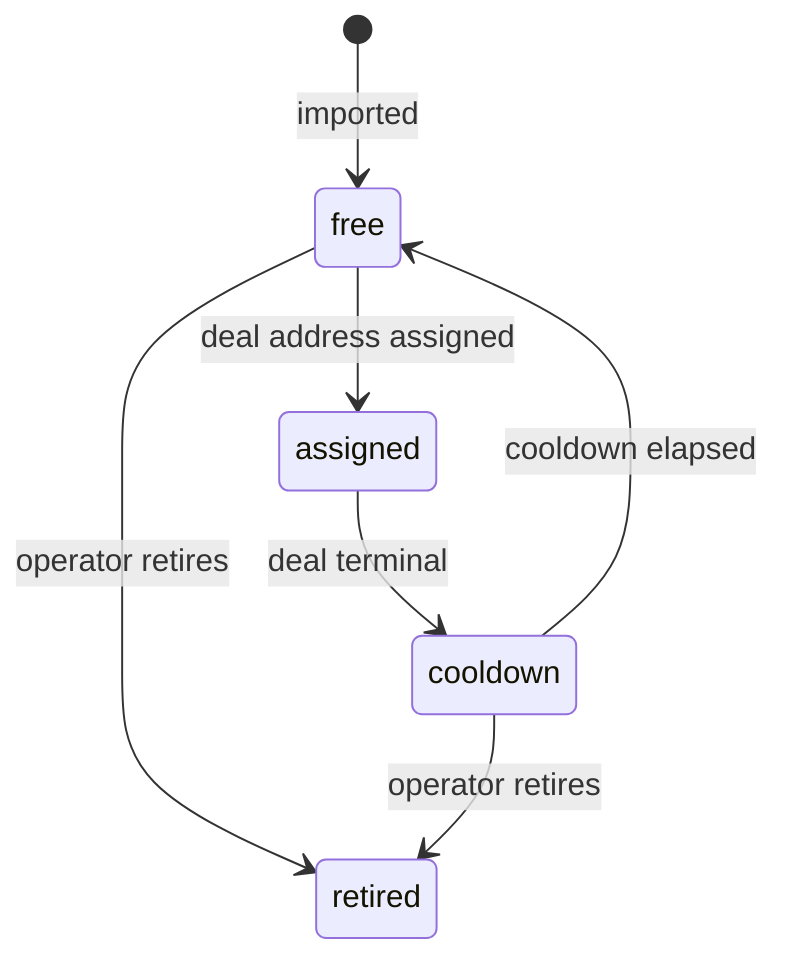

# 07 — Custody and Payments

This is the highest-risk area of the design. Read `09-security-and-limitations.md`
before deploying.

## 1. Custody model

- **One hot wallet key** per chain controls all escrowed funds and all pool addresses.
- Release and refund are automatic transfers from the hot wallet.
- There is no multisig, no cold reserve, and no timelock. That is a deliberate,
  documented choice — and the primary risk of the system.

Key handling:

- Key material lives in an external secret store (KMS or sealed env), never in the DB,
  never in logs, never in a repository.
- The signing process is a separate module with a narrow interface:
  `signTransfer(chain, to, amount_atomic, idempotency_key)`.
- The signer refuses:
  - transfers above `settings.custody.max_transfer_atomic`,
  - transfers to addresses not present in a deal,
  - more than `settings.custody.max_daily_atomic` per UTC day,
  - any transfer whose `idempotency_key` was already used.

## 2. Deposit address pool

Static addresses are pre-generated per chain and stored in `deposit_address`.

- Assignment: `SELECT … FOR UPDATE SKIP LOCKED` over `free` for the chain.
- A deal gets exactly one address; the address is never shared across live deals.
- On completion/cancel/expiry/refund, the address enters `cooldown`
  (default 60 min) so late deposits are still attributed, then returns to `free`.
- The operator can import, retire, and publish the current list. The list shown in the
  community is generated from `status != retired`.
- The pool must be sized for peak concurrent deals per chain plus a reserve
  (default reserve = 20% of `max_open_deals`).

### Why a pool, not derivation

The source publishes a static list and rotates it. A pool reproduces that behavior
while removing the "which deal is this deposit?" ambiguity: the assigned address *is*
the correlation key. It also keeps key handling to one seed.

## 3. Chains and assets

| Chain | Asset | Contract (verify before use) | Gas |
|---|---|---|---|
| BSC | USDT (BEP20) | `0x55d398326f99059fF775485246999027B3197955` | BNB |
| TRON | USDT (TRC20) | `TR7NHqjeKQxGTCi8q8ZY4pL8otSzgjLj6t` | TRX / energy |

Config is data, not code; operators can add a chain by implementing `ChainPort`.

## 4. Deposit watching

- The watcher polls RPC for transfers to every `assigned` address on an interval
  (default 10 s), filtered to the USDT contract.
- It records `deposit` rows keyed by `(chain, tx_hash, log_index)`.
- A deposit is credited to the deal when:
  1. `to == deal.deposit_address`,
  2. `amount_atomic >= deal.amount_atomic`,
  3. confirmations `>= deal.confirmations_required` (15 BSC / 20 TRON).
- Underpayment: deposit is recorded, deal stays `AWAITING_DEPOSIT`, operator is notified.
- Overpayment: deal is credited; excess is recorded for manual return.
- Late deposits to a `cooldown` address are matched to the closed deal and surfaced to
  the operator.

## 5. Sweeping

- Funds are swept from pool addresses to the hot wallet on a schedule and before every
  release if the hot balance is low.
- Sweeps need native gas on the source address; the gas top-up job maintains a small
  BNB/TRX float per pool address.
- Sweep txs are idempotent and recorded; a stuck tx is replaced by fee bump or reported.

## 6. Release and refund

- **Release** (buyer side): transfer `release_atomic = amount_atomic − fee_atomic` from
  hot wallet to `deal.release_address`.
- **Refund** (dispute verdict `refund`): transfer `amount_atomic` back to
  `deal.refund_address` (or the seller's pool address if none), minus policy fee.
- Both are idempotent on `deal_id + direction`.
- A deal reaches `COMPLETED` only after the transfer receipt succeeds.
- Fee is retained in the hot wallet and accounted in `settings.ledger`.

## 7. INR leg (manual)

- The buyer sends INR to the seller's `payment_details` (CDM, CCW, UPI, IMPS, QR cash).
- The buyer marks **I Have Paid** and uploads proof (image/video/PDF).
- Proof is stored encrypted; only the operator can view it.
- The seller verifies receipt out-of-band and presses **Release Payment**.
- There is **no automated UPI/bank verification** in this design.
- Disputes rely on the evidence in `08-operator-and-wizard.md`.

## 8. Reconciliation

Daily job:

1. Sum pool + hot balances per chain from RPC.
2. Sum open-deal liabilities (`funded` and later states).
3. Assert `balances >= liabilities + pending_fees`.
4. Write a signed reconciliation report; alert the operator on mismatch.

## 9. Failure handling

| Case | Action |
|---|---|
| RPC lag / reorg | Do not credit until confirmations; re-check on reorg |
| Stuck release tx | Replace-by-fee (BSC) / re-sign with higher energy (TRON) |
| Wrong-network deposit | Record, do not credit, alert operator |
| Duplicate webhook | Dedupe on `(tx_hash, log_index)` |
| Signer cap hit | Block transfer, alert operator |
| Pool exhausted | New deals stay `AWAITING_CONFIRMATION`; alert operator |

## 10. Ledger

Every movement writes an immutable `ledger_entry`:
`id, chain, direction (in|out), deal_id, tx_hash, amount_atomic, fee_atomic, at`.
Balances are derived from the ledger, not stored as mutable counters.
