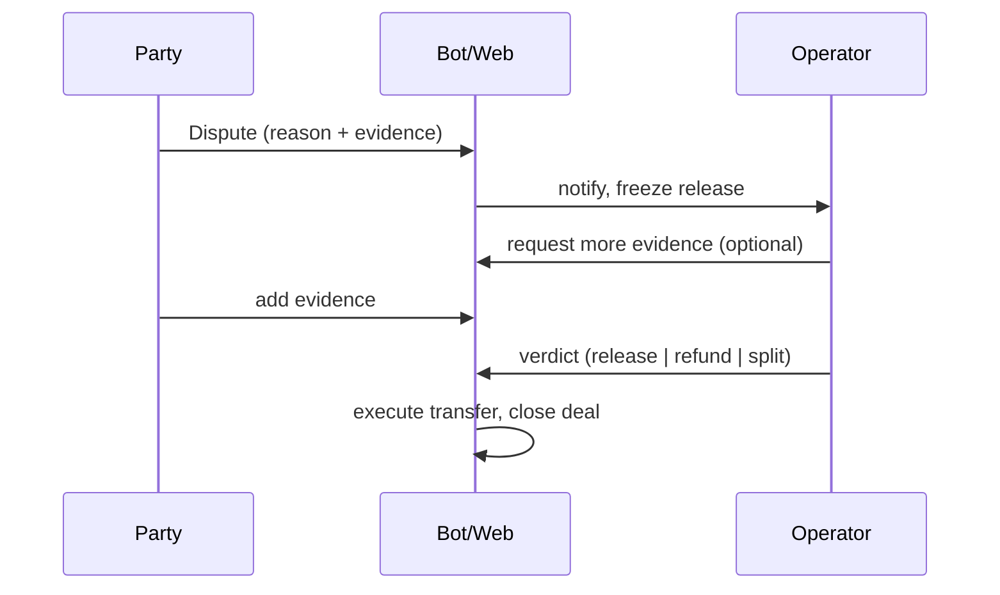

# 08 — Operator Console and First-Run Wizard

There are **no user roles**. Exactly one system operator principal exists, created by the
wizard and protected by TOTP 2FA. It is a principal, not a role hierarchy, and it is the
final authority on disputes.

## 1. Operator console

Lives inside the web adapter at `/operator`. Requires an authenticated operator session
with a verified TOTP code.

### Screens

| Screen | Purpose |
|---|---|
| Dashboard | open deals, pending deposits, disputes, pool availability, balances, alerts |
| Deal inspector | read-only timeline, state, terms hash, deposits, proofs, transfers |
| Dispute queue | evidence, verdict actions (release / refund / split), notes |
| Listings | close/expire listings; no editing |
| Address pool | import, retire, publish list, view assignment |
| Settings | fee, thresholds, timers, safety copy |
| Audit | immutable log of operator actions |

### Authentication

- Single `operator` row created by the wizard; password hash (argon2id) + TOTP secret.
- Session cookie: `HttpOnly`, `Secure`, `SameSite=Strict`, 30-minute idle timeout.
- Rate limit: 5 failed logins / 15 min, then lockout.
- Optional IP allowlist.
- Recovery: one-time recovery codes, shown once at setup.

### Audit

Every operator action writes `operator_audit(actor, action, target, at, meta)`:
`login`, `dispute.verdict`, `deal.force_cancel`, `address.import`, `address.retire`,
`settings.update`, `release.manual`.

## 2. Dispute workflow



- Opening a dispute freezes release immediately; the deal enters `DISPUTED`.
- Evidence kinds: file, text, tx hash, quoted message. Append-only.
- The operator may request more evidence; there is **no appeal** after the verdict.
- No KYC is collected. Unlike the source group, the operator rules on in-room evidence
  only — no identity documents and no bank statements beyond the uploaded proof.
- Verdicts: `release` (pay buyer), `refund` (return seller), `split` (percentage split,
  recorded as two transfers).
- The verdict, note, and executed tx hashes are written to the deal timeline.
- Target turnaround: 24–48 h (configurable). There is no automatic fallback if the
  operator is silent — this is a known risk (see `09`).

## 3. First-run wizard

Runs on a fresh install at `/setup`, before the console is reachable. It writes
`settings` and a redacted `config.toml`; secrets are written to the secret store.

### Steps

1. **Welcome / risk acknowledgement** — display the known limitations; require an
   explicit checkbox.
2. **Branding** — product name, logo, colors, support handle. Clean re-brand only.
3. **Operator** — username, password, TOTP enrollment, recovery codes.
4. **Telegram** — bot token (validate via `getMe`), community chat id, listings topic
   id, verification mode (`none|optional|required`).
5. **Web** — base URL, OIDC issuer/client id/secret, callback URL.
6. **Chains** — BSC RPC, TRON RPC, USDT contracts, confirmations (15/20), address pool
   import (CSV), pool reserve.
7. **Fees** — percent (default 0.5), minimum (0.5 USDT), default payer.
8. **Limits** — max open deals/account, max open listings, form/deposit/INR timers.
9. **Disputes** — SLA hours, evidence rules, verdict options.
10. **Safety copy** — banners, impersonation suffix policy, deposit-address list.
11. **Connectivity checks** — DB, broker, bot `getMe`, RPC block height, OIDC discovery.
12. **Dry run** — a synthetic deal through all states with a mock chain; then **Go live**.

The wizard is idempotent and resumable; it refuses to go live if any check fails.

### Output

```json
{
  "brand": { "name": "…", "support_handle": "@…" },
  "operator": { "username": "…" },
  "adapters": {
    "telegram": { "enabled": true, "surface": "native_room", "verification": "optional" },
    "web": { "enabled": true, "surface": "web_surface", "oidc": { "issuer": "…" } }
  },
  "chains": {
    "bsc": { "confirmations": 15, "pool_size": 20 },
    "tron": { "confirmations": 20, "pool_size": 20 }
  },
  "fees": { "pct": 0.005, "min_atomic": 500000, "payer": "split" },
  "timers": { "form_min": 30, "deposit_min": 30, "inr_min": 30 },
  "limits": { "max_open_deals": 3, "max_open_listings": 3 }
}
```

Schema: `schemas/install-config.schema.json`.
